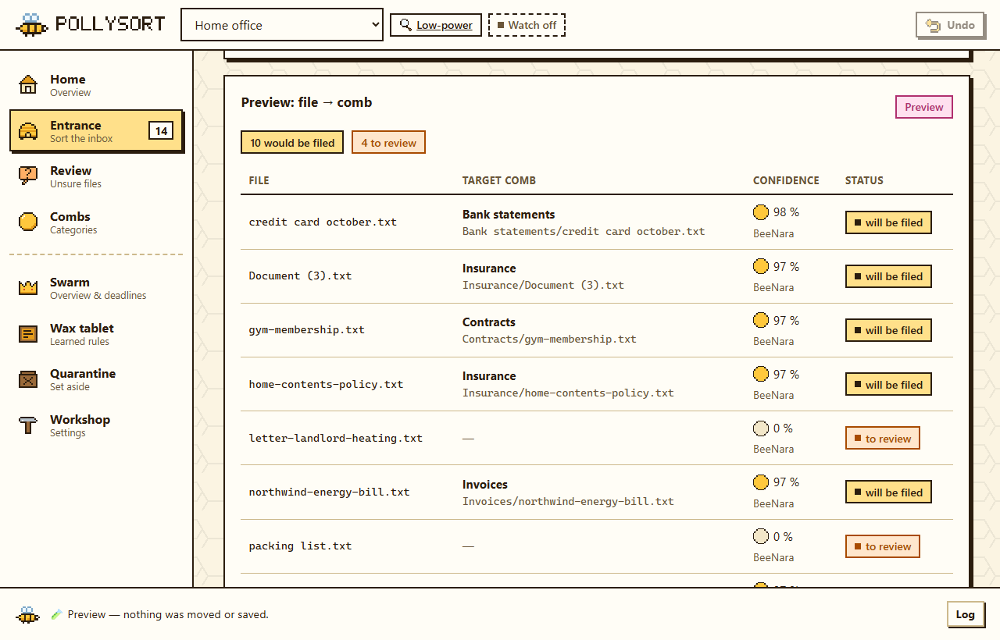
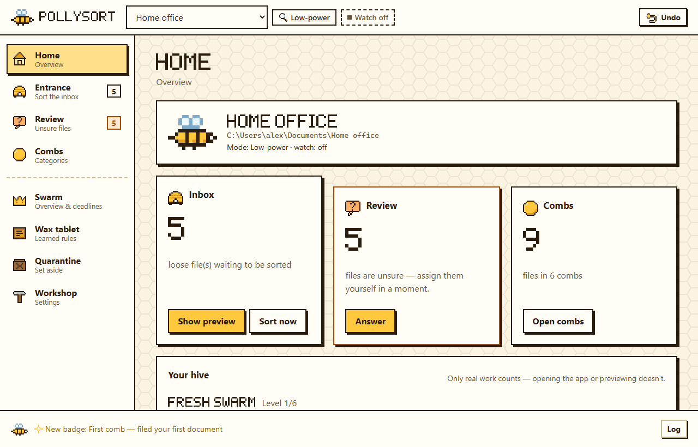
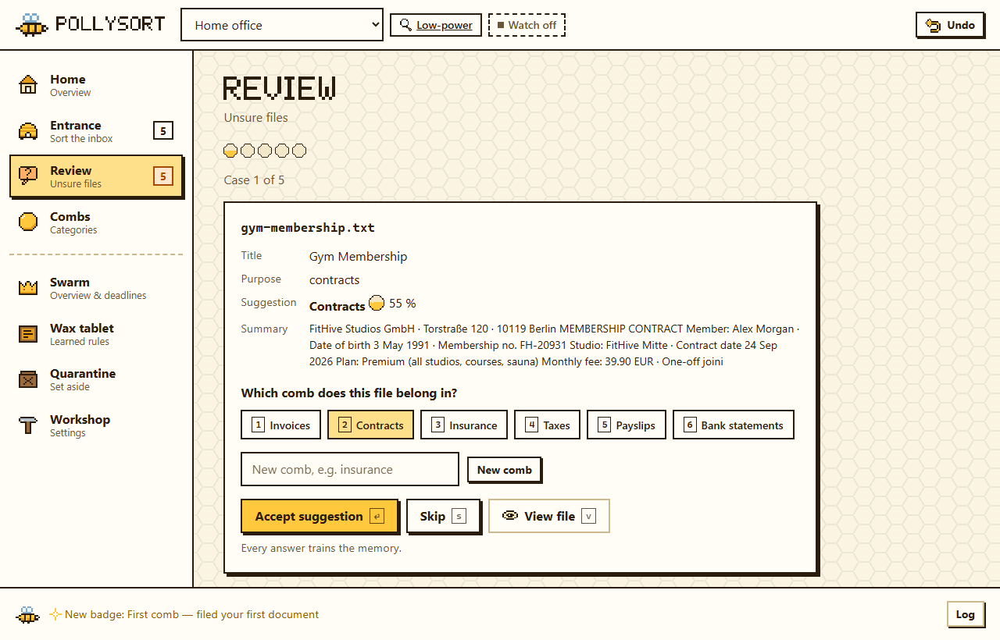
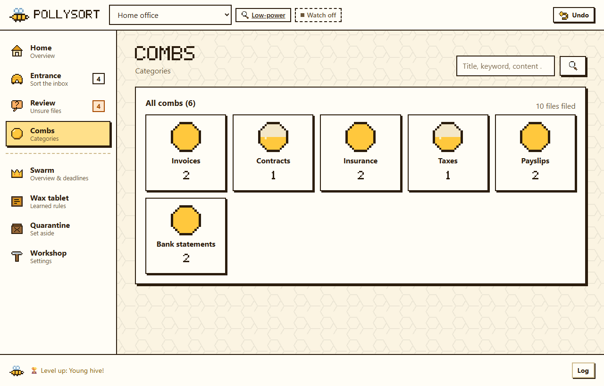
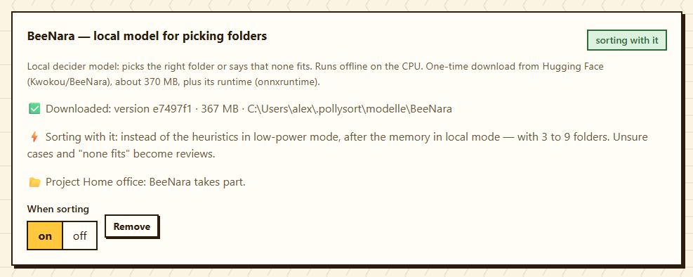

<h1 align="center">
  <picture>
    <source media="(prefers-color-scheme: dark)" srcset="docs/bilder/logo-dark.svg">
    
  </picture>
</h1>

<p align="center">
  <b>A learning document archivist: as an app, in the console or in your browser.</b><br>
  Point it at a folder full of loose files, press <b>Sort</b> and it files them into clean
  category folders, getting smarter with every correction. Local models, no cloud required.
</p>

<p align="center">
  <a href="https://github.com/Akinara-Lab/PollySort/actions/workflows/ci.yml"></a>
  <a href="LICENSE"></a>
  
  
  <a href="https://huggingface.co/collections/Kwokou/beenara-local-document-sorting"></a>
</p>

<p align="center">
  <picture>
    <source media="(prefers-color-scheme: dark)" srcset="docs/bilder/vorschau-dark.png">
    
  </picture>
</p>

PollySort watches a folder, reads each document, works out **what it is** and **what it's
for**, assigns it to a **learning category** and moves it into a visible category folder
("comb"). Unsure cases are collected into a quick review. **Nothing is ever deleted or
overwritten: files are only moved, with undo.** Everything the tool generates (index, memory,
logs, entries, quarantine) lives in **one hidden folder, `.honig/`**, so your directory stays
clean and only the category folders appear.

_Developed by [**Akinara**](https://akinara.de) · Apache-2.0._

> [!WARNING]
> **Beta.** The core is well tested and stable, but commands, settings and file layout may still
> change before 1.0. Your files are safe by design (move-only, never delete), but treat this as
> pre-release software.

> [!NOTE]
> **Language.** English and German are equivalent: the first start asks, English is the
> default, `language de` switches at any time. This README uses the English command names; the
> original German names are shown in parentheses. Still German only: the installer scripts and
> some messages of the scripting CLI `pollysort-cli`.

---

## Table of contents

- [Quick start](#quick-start)
- [Why PollySort](#why-pollysort)
- [Key features](#key-features)
- [Installation](#installation)
- [First run](#first-run)
- [The app (Flugbrett)](#the-app-flugbrett)
- [Everyday workflow](#everyday-workflow)
- [Command reference](#command-reference)
- [How it works](#how-it-works)
- [BeeNara: the local deciders](#beenara-the-local-deciders)
- [What lives where](#what-lives-where)
- [Modes: low-power · local · cloud](#modes)
- [Learning: the Wachstafel](#learning-the-wachstafel)
- [Stage 2: projects, deadlines & notifications](#stage-2-projects)
- [Licence](#licence)
- [Privacy & security](#privacy--security)
- [Development & testing](#development--testing)
- [Roadmap](#roadmap)
- [FAQ](#faq)

---

## Quick start

| | Windows | macOS · Linux |
|---|---|---|
| **1. Python 3.12+** | `winget install Python.Python.3.12` or [python.org](https://www.python.org/downloads/) | macOS: `brew install python@3.12` · Linux: Ubuntu 24.04+ and Debian 13+ already ship it |
| **2. Get PollySort** | on GitHub **Code → Download ZIP** and unpack it, or `git clone` | same |
| **3. Install** | double-click **`install.bat`** in the unpacked folder | `bash install.sh` in the folder |
| **4. Start** | **PollySort** on the desktop or in the Start menu | app menu (Linux) · `~/Applications` (macOS) · or type `pollysort-app` |

On the first start a short setup asks for your language and look (dark, light or automatic),
the folder to sort, the AI mode (with a tick box to download **BeeNara**, the free local
sorting model) and proposes categories from what is already there. Then **Show preview →
Apply** sorts your first files. Nothing moves before you confirm. With an NVIDIA graphics card
(8 GB or more) you can add **BeeNara Big** for large folder trees later, in **Workshop →
BeeNara**.

Prefer the keyboard? Type `pollysort` in a new terminal: same features, as a console. Details,
options and help with problems: [Installation](#installation).

---

## Why PollySort

Most "auto-sorters" force a rigid folder scheme on you and break the moment your documents
don't fit. PollySort is different:

- **It adapts to you, not the other way around.** Categories are not fixed: a vector memory
  grows with every document, and the tool learns your habits from the corrections you make.
- **It respects what you already have.** During setup it looks at your loose files *and* your
  existing subfolders and proposes a structure that extends what you started, instead of
  starting from zero.
- **It is safe by construction.** There is no code path that deletes or overwrites a user
  file. Name clashes get a unique suffix; deletion only ever happens through an explicit,
  confirmed quarantine step.
- **It works without the cloud.** A free offline mode sorts without any network or API key,
  and our own small local model **BeeNara** makes it accurate; **BeeNara Big** handles whole
  folder trees on a graphics card. Add a local **Ollama** model or an **OpenRouter** key for
  full AI analysis: your choice, per project.
- **It knows when to ask.** BeeNara files a document on its own only when it is calibrated to be
  wrong in at most 1 % of such cases; everything else comes to you as a quick review with its
  suggestion.
- **It stays out of your way.** One hidden `.honig/` folder holds everything generated; your
  working directory only ever shows the clean category folders.

---

## Key features

| | Feature |
|---|---|
|  | **Own app, console or browser.** The same core as a program window (`pollysort-app`), an interactive console (`pollysort`) or a browser tab (`pollysort-web`) |
|  | **Content-aware sorting**: title, summary, keywords, function and category per document |
|  | **BeeNara**: our small local model picks the folder (or says "none fits") in about a third of a second on a laptop CPU, offline and free |
|  | **BeeNara Big** *(preview)*: suggests the right folder in whole folder trees of up to ~300 folders, on an NVIDIA graphics card |
|  | **Learning memory (Hive Mind)**: kNN vector memory and a living taxonomy that grows with use |
|  | **Confidence & review**: sure files are filed automatically, unsure ones are queued for you |
|  | **Real-time watch**: a `watchdog` observer sorts or announces new files the instant they land |
|  | **Preview & apply**: dry run first, then apply from cache with **no second AI calls** |
|  | **Ultra Swarm**: parallel analysis for large batches, free and unrestricted |
|  | **Dynamic subfolders**, e.g. file invoices into `Invoices/{year}/{month}` automatically |
|  | **Learns from manual moves**: drag a file between folders, `scan` turns it into a rule |
|  | **Duplicate detection**: SHA-256 dedupe; a second run makes **zero** new AI calls |
|  | **Undo & quarantine**: move-only, unique-suffix collisions, reversible, never auto-deletes |
|  | **Stage 2 project management**: turn a category into a project with charter & deadlines |
|  | **Notifications**: optional Discord / e-mail alerts for due deadlines; `.ics` calendar sync |
|  | **Three modes**: low-power (any PC) · local (AI via Ollama) · cloud (AI via API), per project |
|  | **`doctor` health check**, **DE/EN**, **dark/light**, **abort any prompt** |
|  | **Apache-2.0**: real open source, no feature gates, no project limit, commercial use OK |

---

## Installation

**You need Python 3.12 or newer**, and nothing else: no administrator rights, no compiler, no
Docker. PollySort installs into an isolated environment of its own, so it never clashes with
other Python programs.

### 1. Python

| System | Install | Check |
|---|---|---|
| **Windows** | `winget install Python.Python.3.12`, or the installer from [python.org](https://www.python.org/downloads/) | `py --version` |
| **macOS** | `brew install python@3.12`, or the installer from python.org | `python3 --version` |
| **Linux** | already included in Ubuntu 24.04+, Debian 13+, Fedora 39+; otherwise your distribution's `python3.12` package | `python3 --version` |

> [!TIP]
> Optional but recommended: [**uv**](https://docs.astral.sh/uv/) (`winget install
> astral-sh.uv` · `brew install uv`). The installer uses it if present: fast, isolated and
> easy to update. Without it the installer falls back to `pipx`, then to `pip --user`.

### 2. Get PollySort

- **Without git:** on the GitHub page **Code → Download ZIP**, then unpack it, e.g. into
  `Documents\PollySort`.
- **With git:** `git clone https://github.com/Akinara-Lab/PollySort.git`

### 3. Run the installer

| Platform | Command |
|---|---|
| **Windows** | double-click **`install.bat`**, or `.\install.ps1` in PowerShell |
| **macOS / Linux** | **`bash install.sh`** |
| **Git-Bash on Windows** | **`bash install.sh`** |

The installer

1. checks the prerequisites: the project files are there, and a *real* Python 3.12+ (not the
   Microsoft Store placeholder that only prints an advert);
2. installs PollySort with uv, pipx or pip, including the **`[extract]`** extra (Office and
   HTML text, file-type detection) and the **`[app]`** extra (a native window; not on Linux,
   where PollySort uses a frameless Chromium/Edge window instead);
3. puts the commands on your PATH, **for your user only**: on Windows in the user `Path`
   variable, on Linux and macOS in the startup file your shell actually reads (`~/.zshrc`,
   `~/.bashrc`, `~/.bash_profile`, `~/.config/fish/config.fish`), inside a marked block so a
   second run does not duplicate it;
4. creates a **PollySort** shortcut: Start menu and desktop (Windows), application menu
   (Linux), `~/Applications/PollySort.app` (macOS).

Options (PowerShell spelling in brackets):

- `--dry-run` (`-DryRun`): show what would happen, change nothing.
- `--no-path` (`-NoPath`): install, but leave PATH alone.
- `--no-shortcut` (`-NoShortcut`): no shortcut or menu entry.

Afterwards open a **new** terminal, so the PATH entry takes effect, and check the
installation:

```bash
pollysort-cli doctor     # Python, AI backends, BeeNara, database, extras, memory
```

### What you get

| Command | Opens |
|---|---|
| **`pollysort-app`** | the app in its own window, also behind the desktop shortcut. Closing the window quits PollySort |
| **`pollysort`** | the interactive console |
| **`pollysort-web`** | the app as a tab in your browser; `Ctrl-C` stops it |
| **`pollysort-cli`** | the scripting CLI for automation: `pollysort-cli doctor`, `pollysort-cli scan --mode move`, … |

### Optional: more intelligence

All of these are optional; PollySort sorts without them.

| | What | How |
|---|---|---|
|  | **BeeNara**, the local sorting model (~370 MB, CPU, offline) | Tick it in the setup, use **Workshop → BeeNara → Download** in the app, or type `beenara pull` in the console. Its runtime (`onnxruntime`, `tokenizers`, `numpy`) is installed with it |
|  | **BeeNara Big** for large folder trees (~4.7 GB, NVIDIA GPU with 8 GB or more) | **Workshop → BeeNara → BeeNara Big → Download**, or `beenara big pull` in the console. It checks the graphics card first and installs PyTorch with CUDA to match your driver |
|  | **Ollama** for *local* mode: full AI analysis on your own machine | Install [Ollama](https://ollama.com) and start it. Both models then come with one click each: **Workshop → Ollama → Download** for the language model `qwen3.5:9b` (~6.6 GB) and the memory model (RAG) `nomic-embed-text-v2-moe` (~1 GB), or `ollama pull` in the PollySort console for whatever is missing |
|  | **OpenRouter** for *cloud* mode: best quality, paid per use | Create a key on [openrouter.ai](https://openrouter.ai) and enter it with `key set` in the console |

### Updating

Get the new version (download the ZIP again, or `git pull`) and **run the installer again**; it
replaces the old installation. Your settings, projects, learned memory and downloaded models
stay where they are (`~/.pollysort` and the `.honig` folders). If a new PollySort needs a newer
BeeNara, the Workshop says so; `beenara pull` then fetches only the changed files.

### Manual install

If you'd rather not use the scripts:

```bash
cd PollySort
uv tool install ".[extract,app]"      # or:  pipx install ".[extract,app]"
pollysort-cli doctor
```

| Extra | Brings | Without it |
|---|---|---|
| `[extract]` | DOCX, CSV and HTML as text, file-type detection via libmagic | `mimetypes` and raw text reading; PDFs are always read (`pypdf` is in the core) |
| `[app]` | a native window for `pollysort-app` (pywebview) | a frameless Edge/Chrome window, otherwise a browser tab |
| `[beenara]` | the runtime for BeeNara (`onnxruntime`, `tokenizers`, `numpy`) | `beenara pull` installs it when you need it |
| `[beenara-big]` | the runtime for BeeNara Big (`torch`, `transformers`, `peft`, …) | `beenara big pull` installs it, with **CUDA**: PyTorch from PyPI is CPU-only on Windows, so prefer letting PollySort install it |
| `[full]` | `extract`, `app` and `beenara` | |

Update with `uv tool install --force ".[extract,app]"` (or `pipx install --force …`).

**Run without installing:** from the folder, `python polly.py [path]` always works. If it is
started with an old Python by mistake, it re-launches itself into the project's own `.venv`.

### Uninstalling

| Platform | Command |
|---|---|
| **Windows** | double-click **`uninstall.bat`**, or `.\uninstall.ps1` in PowerShell |
| **Linux / macOS / Git-Bash** | **`bash uninstall.sh`** |

By default this removes only the **application**: the commands, the shortcuts and the PATH
entry the installer added (and that only if nothing else lives in that folder). Add
**`--alles`** (PowerShell: `-Alles`) to also delete the global store `~/.pollysort`:
settings, your OpenRouter key, the project list, notification routes, the input history and
downloaded models (BeeNara, BeeNara Big). That step asks for confirmation.

**Your documents are never touched**, under any option. Neither are the hidden `.honig`
folders inside your projects: they hold the catalogue, the learned memory and `papierkorb/`,
the quarantine, which may still contain real files you set aside but never purged. The
uninstaller lists those folders instead, so you can decide yourself. A deinstaller that
quietly takes user data with it is data loss with a clean conscience, and PollySort's first
principle is that nothing is ever deleted.

Both scripts accept `--dry-run` to show what would happen without changing anything.

### Troubleshooting

| Problem | Fix |
|---|---|
| **`pollysort` is not found** after installing | Open a *new* terminal: the PATH entry only applies there. Still missing? Run the installer again and read its last lines, or start with `python polly.py` from the folder |
| **"Python not found"**, although it is installed (Windows) | `python` is often only the Microsoft Store placeholder. Install Python as above, or switch the placeholder off: *Settings → Apps → Advanced app settings → App execution aliases* |
| **PowerShell refuses `install.ps1`** (execution policy) | Use `install.bat`: it allows the script for this one run. Or: `powershell -ExecutionPolicy Bypass -File install.ps1` |
| **Windows warns about `install.bat`** from the ZIP | Files from the internet are marked. Right-click the ZIP → *Properties* → *Unblock* before unpacking, or start `install.bat` from a terminal |
| **The app opens in a browser tab**, not in a window | The `[app]` extra is missing and there is no Edge or Chrome. Run the installer again. On Linux the installer leaves `[app]` out (pywebview needs GTK/Qt bindings from your distribution); with Chromium or Chrome installed you still get a window of its own |
| **BeeNara download aborted** | Start it again: it resumes where it stopped and checks every file. Behind a firewall, `HF_ENDPOINT` can point to a Hugging Face mirror |
| **BeeNara is downloaded but does not sort** | `beenara` (or the Workshop card) says why: switched off, an older model version, the runtime missing or outdated, or the project has fewer than 3 or more than 9 folders. `beenara pull` fixes the first three |
| **BeeNara Big refuses to download** | It needs an NVIDIA graphics card with at least 8 GB. To run it on the CPU anyway (seconds to minutes per document), set `POLLYSORT_BEENARA_BIG_CPU=1` and pull again |
| **BeeNara Big runs on the CPU** although there is a GPU | The Workshop shows "Runs on the CPU". Run `beenara big pull`: it replaces a CPU-only PyTorch with the CUDA build matching your driver. Then restart PollySort |
| **Local mode sorts, but the memory learns nothing** | The embedding model is missing in Ollama (`doctor` warns). **Workshop → Ollama → Memory model (RAG) → Download**, or `ollama pull memory` in the PollySort console |
| **Ollama crashes** on the GPU (driver issues) | Nothing to do: PollySort falls back to the CPU (`num_gpu: 0`) automatically, slower but working |
| **Something else** | `pollysort-cli doctor` names what is missing. The app logs to `~/.pollysort/app.log`. Issues welcome: [GitHub Issues](https://github.com/Akinara-Lab/PollySort/issues) |

---

## First run

**In the app** (desktop shortcut or `pollysort-app`), a setup assistant does everything:
**look (language, theme, work mode) → folder → name → mode → categories → subfolders →
watch**. In the mode step a tick box downloads BeeNara along with it. For categories it looks
at your loose files *and* your existing folders and proposes a structure (existing subfolders
count as categories you already use). At the end, **Show preview** shows where each file would
go.

**In the console:**

```bash
pollysort                    # opens the most recently used project
pollysort "C:\path\to\dir"   # opens/creates a project at this path
```

A **project** is just a folder whose documents get sorted; the loose files in it are your
inbox. PollySort does **not** assume the current directory: it remembers your projects.

On the **very first launch** a one-time setup clarifies the AI backend (it detects a local
**Ollama** and offers to store an **OpenRouter** key) and offers to download **BeeNara**
(~370 MB plus its runtime, see [BeeNara](#beenara-the-local-deciders)); Enter means "later",
`beenara pull` (`beenara laden`) fetches it any time. Then a short **3-step tutorial** appears
(**pick a folder → `preview` → `sort`**), and the wizard walks you through the project setup.

**Setup order: Name → AI mode → Categories → Subfolders → Watch.** In local and cloud mode the
**AI** analyzes the documents for the category proposal; in low-power mode a heuristic does.
Each project stores its config in `.honig/hive.toml`, so **multiple projects run
independently** side by side.

```text
🐝  PollySort
──────── First-time setup ────────
🦙  Local Ollama detected — AI can run for free & privately on your machine.
🔑  Store an OpenRouter API key? [y/N]: n

🐝  Welcome! No project yet.
  📂 Path to the project folder: C:\Users\me\Documents\office
──────── Set up project ────────
  1) Project name [office]: Law firm
  2) AI mode — how should documents be classified?
       [1] Low-power — heuristics only: instant, free, runs on any PC
       [2] Local — AI on your machine (Ollama), free & private
     Choice [2]: 2
  3) Categories — how should filing work?
       [1] Proposal — look at files & existing folders (the AI reads them)  (recommended)
       [2] Standard  ·  [3] Custom
     Choice [1]: 1
  📁  14 file(s) examined (AI analysis, 2 of them existing folders) — proposal:
       Tax 2023     ██████████ 4 · existing
       Invoices     ███████ 3
       Photos       █████ 2 · existing
       Contracts    █████ 2
       …
     Accept? [Y/n]: y
  4) New files in the inbox (check every ~10 s)?
       [1] off  ·  [2] announce only  ·  [3] sort immediately
     Choice [1]: 3
✅  'Law firm' · 6 categories · mode ollama · inbox: auto-sort

🐝 office ▸ sort
🍯  10 file(s) sorted: 3 → Invoices, 2 → Contracts, 2 → Photos, …
🎉  Cleanly sorted — nothing left behind!
```

Re-opening the same folder loads the config (no wizard). `setup` reconfigures, `projects` lists
all projects, `switch <n>` changes project.

> [!TIP]
> **Abort anytime.** Any interactive prompt (setup, review, …) can be left cleanly by typing
> `abort` / `bye` / `exit` (German: `abbruch`) or pressing **Ctrl-C**. The action is **not**
> executed and nothing is lost.

---

## The app (Flugbrett)

Prefer clicking to typing? **PollySort is also an application of its own**, called the
*Flugbrett* (the landing board at a hive's entrance). Start it from the desktop / Start menu
(Windows), the application menu (Linux) or `~/Applications` (macOS), type `pollysort-app`, or
`app` (`anwendung`) inside the console. Closing the window quits PollySort.

<table>
  <tr>
    <td width="50%">
      <picture>
        <source media="(prefers-color-scheme: dark)" srcset="docs/bilder/zuhause-dark.png">
        
      </picture>
      <p align="center"><b>Home</b>: what is waiting, at a glance</p>
    </td>
    <td width="50%">
      <picture>
        <source media="(prefers-color-scheme: dark)" srcset="docs/bilder/rueckfragen-dark.png">
        
      </picture>
      <p align="center"><b>Review</b>: keys 1–9, Enter, s, v, as in the console</p>
    </td>
  </tr>
  <tr>
    <td width="50%">
      <picture>
        <source media="(prefers-color-scheme: dark)" srcset="docs/bilder/waben-dark.png">
        
      </picture>
      <p align="center"><b>Combs</b>: re-file by picking or dragging; PollySort learns</p>
    </td>
    <td width="50%">
      <picture>
        <source media="(prefers-color-scheme: dark)" srcset="docs/bilder/beenara-dark.png">
        
      </picture>
      <p align="center"><b>Workshop → BeeNara</b>: both models, and which one sorts</p>
    </td>
  </tr>
</table>

| Command | Opens |
|---|---|
| `pollysort-app` | its own window: native via the `[app]` extra (pywebview), otherwise a frameless Edge/Chrome app window, otherwise a browser tab |
| `pollysort-web` | a tab in your browser; `Ctrl-C` stops it |

```bash
pollysort-app                         # last used project, own window
pollysort-app --window app            # force the Edge/Chrome app window
pollysort-web "C:\path\to\dir"        # a specific folder in the browser
pollysort-web --no-browser --port 9000
```

Both run a small local server on **127.0.0.1 only** with a one-time session token. On Windows
`pollysort-app` is installed as a GUI program (no console window); diagnostics go to
`~/.pollysort/app.log`.

- Everything the console does day to day: **home**, **entrance** (preview → apply with live
  progress), **review**, **combs**, **swarm & calendar**, **rules & memory**, **quarantine**,
  **workshop** (settings, BeeNara, BeeNara Big, model choice) and a **setup wizard** that also
  does the first run.
- **Retro pixel look, calm enough for work:** a self-drawn pixel font and pixel icons instead of
  emojis (the icons in this README come from the same sprites), the console's colour meaning,
  WCAG AA contrast, dark/light/auto. Levels and badges come only from real work.
- **Work mode:** one click for subtle animations, hidden levels/badges and plain words before
  the bee terms ("Categories" above "Combs"). Animations can be set to full · subtle · off, and
  the system's *reduce motion* setting always wins.
- **No new dependency, no cloud:** standard-library server, session token, host/origin checks
  and a strict Content-Security-Policy. API keys and notification credentials are only ever
  shown masked; you still enter them in the console (`key set`, `routes setup`).

Design notes, glossary and the test plan live in [`docs/flugbrett.md`](docs/flugbrett.md); the
style tile is served at `/musterbuch.html`.

---

## Everyday workflow

1. **Drop** loose files into your project folder.
2. **Preview** (`preview`, `v`) to see where they'd go, then **apply**. Applying costs no extra
   AI calls.
3. Or **sort** (`sort`, `s`) directly. Sure files move into category folders; unsure ones stay
   put.
4. **Review** (`review`, `r`) the unsure ones quickly: each answer trains the memory.
5. **Watch** (`watch`) keeps the inbox monitored in real time.
6. Correct a mistake by re-filing it in **Combs**, or with **`assign <id> <category>`**:
   PollySort learns a rule from it.

---

## Command reference

`help` groups commands into three tiers: **Daily**, **Situational**, **Pro**. Commands below
list the **English alias** first and the original **German** name in parentheses.

### Daily

| Command | What it does |
|---|---|
| `home` (`start`) | Back to the **home screen** (banner + overview): current project (mode, inbox, open reviews, due deadlines) + all projects. Works from anywhere. |
| `sort` (`sortiere`, `s`) | File the loose documents into category folders |
| `preview` (`vorschau`, `v`) | Show the plan, then **"apply now? [Y/n]"**. Applying reuses the cache, **no second AI calls** |
| `review` (`rueckfragen`, `r`) | Assign the unsure cases quickly yourself |
| `status` | What's here, what's already sorted? |
| `list [category]` (`liste`) | List sorted entries |
| `find <word>` (`suche`) | Search titles / keywords / summaries |
| `app` (`anwendung`) | Open PollySort in its own window; closing it returns to the console |
| `web` (`oberflaeche`) | Open PollySort in the browser (Flugbrett); `Ctrl-C` returns to the console |

### Situational

| Command | What it does |
|---|---|
| `watch` (`wache`) | Monitor the inbox in **real time** (watchdog); announce or sort new files instantly. Ctrl-C stops. |
| `sort turbo [N]` | **Ultra Swarm**: analyze many files in parallel (default 10 workers); same result, much faster |
| `scan` (`sweep`) | Check the whole folder for manual changes (moved/changed/new/gone) and **learn from hand-moves**; free, no AI call |
| `import <folder>` (`importiere`) | Sort files from another folder into here |
| `assign <id> <cat>` (`zuordnen`) | Correct an assignment (memory learns) |
| `reanalyze <id>` (`analysiere`) | Re-analyse one entry; asks before re-filing it |
| `subfolder <cat> <pattern\|off>` (`unterordner`) | Dynamic subfolders per category, e.g. `{year}/{month}`, dated by the document's own date (e.g. invoice date), not by a due date |
| `duplicates [cleanup]` (`dubletten [aufraeumen]`) | Show detected duplicates · move them to quarantine |
| `trash <id>` / `empty` (`papierkorb` / `leeren`) | Quarantine / permanently delete (with confirmation) |
| `restore <id>` (`zurueckholen`) | Bring a file back from quarantine (into its category) |
| `undo` (`rueckflug`) | Reverse the last move |
| `charter [category]` (`wabenbau`) | Turn a category into a **project**: charter, stakeholders, deadlines |
| `calendar [notify]` (`kalender [melden]`) | Show deadlines · send due reminders via the notification routes |
| `swarm` (`schwarm`) | Overview: Queen & bees (combs, open cases, projects, deadlines) |
| `recommend [para\|johnny\|dewey]` (`empfehlung`) | Filing-strategy suggestions + dynamic hints |

### Pro

| Command | What it does |
|---|---|
| `new [path]` (`neu`) · `switch [n]` (`wechsel`) | Create a project · switch to another |
| `projects` (`projekte`) · `setup` | List all projects · reconfigure the current one |
| `mode <low\|local\|cloud>` (`modus`) | Low-power (heuristics, BeeNara) · local (Ollama) · cloud (API) for this project; the old names `offline`/`ollama`/`online` still work |
| `model [name\|list]` (`modell`) | Switch the OpenRouter model at runtime |
| `key [test\|set\|remove]` (`schluessel`) | Check / renew / remove the OpenRouter key |
| `routes [setup\|test]` (`flugrouten`) | Discord / e-mail notifications (opt-in) |
| `reflect` (`reflektiere`) · `rules [clear]` (`wachstafel [leeren]`) | Derive rules from your corrections · show/clear them |
| `memory [approve\|rebuild]` (`gedaechtnis`) | Learned categories + merge/new proposals · `rebuild` re-embeds after a model change |
| `enrich [on\|off\|now]` (`nacherfassen`) | Local mode: let the AI refine titles & summaries after sorting |
| `person <name> <cat,..>` | Set responsibility in the background |
| `doctor` | Health check: Python, AI provider, local models, BeeNara, database, extraction extras, memory |
| `beenara [pull\|on\|off\|remove]` (`beenara [laden\|an\|aus\|entfernen]`) | [BeeNara](#beenara-the-local-deciders), the local decider model: download it with its runtime (~370 MB, checksum-verified, resumes after an interruption) · switch it on/off · remove it. Without an argument: is it sorting, and if not, why |
| `beenara big [pull\|remove]` (`beenara big [laden\|entfernen]`) | [BeeNara Big](#beenara-big-whole-folder-trees): check the graphics card, download it (~4.7 GB) with PyTorch/CUDA · remove it. Without an argument: is it ready, and on the GPU or the CPU |
| `beenara model <auto\|small\|big>` (`beenara modell <auto\|klein\|big>`) | Which model sorts when both are there: **auto** (BeeNara for 3–9 folders, Big for more) · only BeeNara · only Big |
| `ollama [pull [language\|memory\|<model>]]` (`ollama [laden [sprache\|gedaechtnis\|<modell>]]`) | The two Ollama models for *local* mode: without an argument, is Ollama running and which of the language model and the memory model (RAG) it has · `pull` downloads what is missing, through Ollama with progress · `pull language` / `pull memory` one of them · `pull <model>` any other Ollama model, e.g. `ollama pull qwen3.5:9b` as `doctor` suggests |
| `language <de\|en>` (`sprache`, `lang`) | Switch UI language |
| `theme` (`thema`) · `view` (`ansicht`) | Dark/light mode · static view or classic log |
| `help` (`hilfe`) / `exit` | This help / leave the console |

---

## How it works

### The sorting pipeline (per file, isolated: one bad file never aborts a run)

1. **Scout / Guard**: landing check, MIME, size limit, **SHA-256**; duplicate & crash recovery
   via the hash. The `.honig/` and category folders are **not** re-scanned. A second run over
   the same set makes **zero** new AI calls.
2. **Extractor**: a multimodal LLM call (or the heuristic in low-power mode) returns title,
   summary, keywords, function and a category. The prompt requires the model to pick **exactly
   one of the known categories**; a returned label is then **snapped** onto the known set
   (`snap_category`). Broken JSON → repair retry → fallback model → otherwise a metadata-only
   entry flagged for review.
3. **Assign + Inspector (confidence)**: the memory (kNN) confirms or contradicts the label.
   **Confidence ≥ threshold (0.75)** → filed automatically; below → **review**.
4. **Persist & move**: the entry is written **first** (crash recovery), then **only surely
   assigned** files move into `<Category>/[{year}/{month}/…]` (collision-safe, logged for
   undo). Unsure and error cases **stay put**, so the only loose files left are the ones
   needing you.
5. **Memory**: every successful assignment is embedded; category centroids grow over time.

If the AI fails repeatedly mid-run (≥ 3 in a row), the run **falls back to low-power mode**
(heuristics) for the rest instead of producing a pile of errors.

### Local mode: memory → one-token decision → review

Writing a title and summary is the slow part of an AI analysis; the category itself is a
handful of tokens. In **local mode**, PollySort therefore decides first and describes later:

1. **Memory.** The start of the document is embedded and compared with everything already
   filed. If the closest known document is very similar *and* clearly closer than any other
   category, memory decides alone, without an AI call.
2. **One-token decision.** Otherwise the model picks the category by number, answering with a
   single token; the confidence comes from its token probabilities.
3. **Review**, if the model says "none of these fit" or isn't sure.

Afterwards the AI **refines titles and summaries** of the files it just filed (`enrich`,
Ctrl-C skips, the next run continues). The files are already in the right folder by then.

Measured on 70 test documents with `qwen3.5:9b` (57 unique, 13 exact duplicates):

| | per document, GPU | per document, **CPU only** | correct |
|---|---|---|---|
| before (full analysis per file) | 22.2 s | 48.7 s | 97 % |
| now | **0.21 s** | **4.0 s** | 56 of 57 |

About half of the documents were decided by memory alone. With
[BeeNara](#beenara-the-local-deciders) downloaded, it takes over step 2 from the language model
(BeeNara Big does the same in larger folder trees, as a suggestion). Cloud mode is unchanged.

### Preview → apply

`preview` runs a dry run that **fills an analysis cache** (no persisting, no moving), then asks
**"apply? [Y/n]"**. Answering yes runs the real pass **from the cache**, so applying costs
**no second AI calls**, and the preview stays side-effect-free until you confirm.

### Ultra Swarm

`sort turbo [N]` warms the expensive AI analyses **in parallel** into that same cache; the
actual filing (DB, move, memory) stays **single-threaded**, so there are no race conditions and
the result is identical to a sequential run, just much faster for big batches. Fully
included, no activation needed.

---

## BeeNara: the local deciders

**BeeNara** and **BeeNara Big** are two models Akinara trained for exactly one question:
*which of these folders does this document belong in, or none?* Both run on your own machine,
are calibrated, and are far better than small LLMs at noticing that **no** folder fits. Both are
open (Apache-2.0) on Hugging Face:
[**BeeNara collection**](https://huggingface.co/collections/Kwokou/beenara-local-document-sorting).

| |  [**BeeNara**](https://huggingface.co/Kwokou/BeeNara) v0.4 |  [**BeeNara Big**](https://huggingface.co/Kwokou/BeeNara-Big) v0.4 |
|---|---|---|
| **For** | 3 to 9 folders | whole folder trees, 3 to about 300 folders (trained up to 500) |
| **Runs on** | any CPU, about 0.2–0.3 s per document on a laptop | an NVIDIA GPU with 8 GB or more |
| **Download** | ~370 MB (ONNX, 8-bit) | ~4.7 GB (adapter 164 MB + base model 4.6 GB) |
| **Files on its own** | yes, when it is calibrated to be wrong in at most 1 % of such cases | the same, but only in trees of 3–9 folders; with more folders every answer is a **suggestion** in review |
| **Built on** | [mmBERT-base](https://huggingface.co/jhu-clsp/mmBERT-base) | [Qwen3.5-2B-Base](https://huggingface.co/Qwen/Qwen3.5-2B-Base) with LoRA |

<p align="center">
  <picture>
    <source media="(prefers-color-scheme: dark)" srcset="docs/bilder/beenara-dark.png">
    
  </picture>
</p>

### How they sort

- **Low-power mode:** the model decides instead of the heuristics (titles and summaries stay
  heuristic). **Local mode:** after the memory, instead of the one-token decision.
  **Cloud mode:** not used.
- **Which model:** `beenara model auto` (the default) uses BeeNara for 3–9 folders and BeeNara
  Big for larger trees. `small` or `big` forces one of them; outside its range the usual path
  decides. Without Big, nothing changes. In the app: **Workshop → BeeNara → Which model sorts**.
- **Unsure or "none fits" → review**, with the model's favourite as the suggestion. No second
  model guesses afterwards.
- **Your rules still win:** a learned Wachstafel rule, or a memory that clearly points to
  another folder, takes precedence. Files without local text (images) take the usual path.

### BeeNara: 3 to 9 folders, on the CPU

- **Files only what it is sure of.** BeeNara v0.4 sorts a document on its own only above a
  **risk threshold**: with 90 % confidence, at most 1 % of the documents it files automatically
  land in a wrong folder (Learn-then-Test). Everything else is a review with its suggestion.
- **Measured** ([model card](https://huggingface.co/Kwokou/BeeNara)): on a benchmark with folder
  trees and names it has never seen, its answer is right in **91.5 %** of the tasks (v0.3 on the
  same tasks: 85.5 %). It files **59 %** of these tasks automatically, and **0.3 %** of those
  were wrong (v0.3: 21.5 % and 2.5 %). On PollySort's own 70 test documents with the right folder
  missing, it filed 4 insurance certificates into *vertraege* (contracts) when *versicherung* was
  missing; with folder descriptions, none.
- **Reads the start and the end** of long documents, where totals, signatures and closing lines
  are.
- **Concrete folder names work best.** *Invoices*, *Payslips* or *Insurance* are recognised
  reliably. Catch-all folders such as *Letters* or *Correspondence*, and very short documents
  (a line or two), usually end up in review.
- `beenara pull` (or **Workshop → BeeNara** in the app) downloads a fixed model version,
  verifies every file and installs the runtime (`onnxruntime`, `tokenizers`, `numpy`) into the
  environment PollySort runs in. `beenara off` switches it off without deleting it. It uses up
  to 6 CPU threads; `POLLYSORT_BEENARA_THREADS` overrides that.

### BeeNara Big: whole folder trees

- **Sees the whole tree at once.** One pass over up to ~300 folders, with the start and end of
  the document (up to 2,048 tokens). On held-out trees it finds the right folder in **92–94 %**
  (3–24 folders), **89 %** (25–49), **82–84 %** (50–199) and **66 %** (200 and more) of the
  cases, **84 %** overall ([model card](https://huggingface.co/Kwokou/BeeNara-Big)).
- **Files on its own only in small trees.** v0.4 is the first version with a risk threshold:
  with 3–9 folders it files **57 %** of the tasks automatically, **0.9 %** of those wrong. For
  larger trees its calibration found no threshold that keeps automatic decisions at ≤ 1 % wrong,
  so every answer there becomes a review with its favourite.
- **Needs a graphics card.** `beenara big pull` (or the Workshop) first checks for an NVIDIA GPU
  with at least 8 GB, then downloads the adapter and the base model from fixed commits with
  checksums, and installs PyTorch with CUDA to match your driver. In a short test on a laptop
  GPU (RTX PRO 1000, 8 GB, 16 folders) it took about 0.1–0.2 s per document and 4.6 GB of
  graphics memory. On a CPU it needs
  seconds to minutes per document; `POLLYSORT_BEENARA_BIG_CPU=1` allows that anyway.
- **Local mode with Ollama:** both share the graphics memory. With 8 GB, a large Ollama model
  and Big may not fit at the same time; PollySort then reports it once and carries on without
  Big.

---

## What lives where

```
<your folder>/
├── Invoices/          ← visible category folders (the result)
├── Contracts/
├── Minutes/
├── note.txt           ← loose files still awaiting your go-ahead ('review')
└── .honig/            ← ONE hidden folder with everything generated:
    ├── katalog.db         · searchable index
    ├── eintraege/         · one Markdown + JSON entry per file (PKM-ready)
    ├── gedaechtnis.db     · the learning category memory
    ├── taxonomie.toml     · learned categories + responsibilities
    ├── korrekturen.jsonl  · feedback from your assignments
    ├── wachstafel.md      · learned, human-readable project rules
    ├── papierkorb/        · quarantine (never auto-emptied)
    ├── journal.md         · what happened when
    └── log.jsonl          · structured log (metadata only, never contents)
```

The Markdown entries start with YAML front matter and open straight in Obsidian, Logseq or
Notion. Global settings (last project, credentials, project registry, `app.log`) live under
`~/.pollysort/`, outside your working folders (relocatable via `POLLYSORT_HOME`); downloaded
models sit in `~/.pollysort/modelle/BeeNara/` and `~/.pollysort/modelle/BeeNara-Big/` (with the
base model in `basis/`; `HF_ENDPOINT` points the download at a mirror). An old `~/.beehive/` from earlier versions is migrated automatically: copied, never
deleted.

> [!NOTE]
> The hidden folder is named `.honig` ("honey") and categories are internally called "combs"
> (`Waben`), part of the tool's bee theme. You never need to touch these names.

---

## Modes

One interface, three modes, chosen per project (`mode low | local | cloud`):

- **Low-power**: pure heuristics from filename, text start, file type and category names
  (self-named/discovered categories work without hard-coded rules). Instant, free, no network,
  no model: runs on any PC. With [BeeNara](#beenara-the-local-deciders) downloaded, a small
  local model picks the folder instead (CPU, about a third of a second per document, still free
  and offline); BeeNara Big adds suggestions for large folder trees on a graphics card.
- **Local**: AI on your own machine via Ollama (free & private); automatic CPU fallback if
  the GPU backend crashes. Decides in **three stages** (see *How it works*), fast enough for a
  laptop without a GPU.
- **Cloud**: AI via an API (OpenRouter, multimodal, best quality); the key is stored globally.

Switching is config, not code. Without a key, cloud mode degrades cleanly to low-power mode.
The old mode names (`offline`, `ollama`, `online`) keep working.

---

## Learning: the Wachstafel

When you correct an assignment (`assign <id> <category>`, or by re-filing in the app), or when
`scan` notices you moved a file **from one category folder to another by hand**, the Queen
studies the corrections and **inscribes rules in plain language** into `.honig/wachstafel.md`
(e.g. *"telekom → Invoices"*). `reflect` shows the derived rules and only writes them after you
confirm. Dragging an open question by hand into the folder PollySort suggested counts as
answering it: `scan` files it and the memory treats it as confirmed.

On the next `sort`, those rules are applied: online they're injected into the LLM prompt as
"learned project rules", offline they're applied directly. So each project adapts specifically
to you.

> [!NOTE]
> **Safe & project-scoped:** **no code is ever generated**; learning happens purely through
> the `wachstafel.md` text file. Rules apply **only** within their project and never leak into
> another. `rules` shows them, `rules clear` discards them.

---

## Stage 2: projects

`sort` brings loose files into combs (categories). **`wabenbau`** turns a comb into a real
project:

- Generates a **charter** (`Bienenstock.md`) in the category folder: goal, status, stakeholders,
  contents, open tasks and deadlines; missing info is asked for interactively.
- Records deadlines in the swarm calendar and writes a real **`.ics` file** you can subscribe to
  in Apple Calendar, Outlook or Google.
- **Notification routes (opt-in):** via `routes setup` you can give the guard bees **Discord**
  (bot token + channel) and/or **e-mail** (SMTP presets for Gmail/Outlook or custom). When a
  deadline is due they actually notify you (`calendar notify`, or automatically in the `watch`
  service; anti-spam included).

> [!NOTE]
> **Credential seal:** notification credentials live **only** locally in
> `~/.pollysort/flugrouten.toml` (chmod 600, env override possible), **never** in the project and
> **never** in an LLM prompt. Discord/SMTP calls run completely independently of the AI;
> sensitive fields are masked in `log.jsonl`. No notifications are sent without your setup.

---

## Licence

PollySort is licensed under the **[Apache License 2.0](LICENSE)**: real, OSI-approved open
source.

- **Everything is included.** No project limit, no feature behind a gate, no licence key.
  **Ultra Swarm** runs free.
- **Commercial use is allowed**: your own data and paid client work alike.
- **Fork it, change it, ship it.**
- **Patent grant included** (Apache-2.0 §3); that is why Apache rather than MIT.

What the licence does *not* cover is the name and logo: "PollySort" and "Akinara" are
trademarks of Akinara. See **[`TRADEMARK.md`](TRADEMARK.md)** for what needs no permission.
Short version: do anything you like with the code, but please fork under your own name.

**So how is this funded?** Akinara is working on **PollySort Server** (working title), a
separate repository: the complete PollySort for teams and organisations, hosted on your own
systems (Docker, Python package or system service), with a web interface for users and admins.
The app here will be able to connect to it. It will be *source-available*: **free for internal
use in any organisation, however large**; only whoever installs or runs it for others pays a
small yearly licence. Licence and details follow with its first release. This repository does
not need it: the local tool here stays complete, free and Apache-2.0.

Contributions welcome: **[`CONTRIBUTING.md`](CONTRIBUTING.md)** ·
Report vulnerabilities privately: **[`SECURITY.md`](SECURITY.md)**.

---

## Privacy & security

- **Low-power / local:** no document content ever leaves your machine. BeeNara and BeeNara Big
  run locally too; only their one-time downloads come from Hugging Face, and PollySort never
  runs code from there (the model runtimes ship with PollySort).
- **Cloud:** document content is sent for analysis (shown at onboarding). Exclude
  confidential files via `.beeignore`/`exclude`, or use low-power or local mode.
- **No document content is ever logged** (`log.jsonl` holds metadata only).
- **Move-only guarantee:** no code path deletes or overwrites a user file; deletion happens only
  through the confirmed `trash` → `empty` flow.
- **The app listens on 127.0.0.1 only**, with a session token, host/origin checks and a strict
  Content-Security-Policy.
- API keys and credentials are stored locally only and never enter an AI prompt.

---

## Development & testing

```bash
# editable install with all extras plus test & lint tools
uv pip install -e ".[full,dev]"    # or: python -m venv .venv && pip install -e ".[full,dev]"

pytest -q
ruff check src polly.py tests
```

The screenshots in this README come from `python tools/readme_bilder.py`: it builds a demo
project with invented documents in a temporary `POLLYSORT_HOME`, starts the app and
photographs it with Edge or Chrome via [Playwright](https://playwright.dev/python/)
(`pip install playwright`, no browser download needed). Your own data is not touched; your
downloaded models are only linked in. The logo and the icons are drawn from the app's own pixel
sprites by `python tools/readme_grafiken.py` (standard library only).

Stack: Python ≥ 3.12 · `cmd` REPL + `pyreadline3` · `rich` output · `pydantic v2` models ·
`SQLAlchemy 2 Core`/SQLite index · `httpx` (OpenRouter/Ollama) · `watchdog` · `pypdf` (core) +
`markitdown` (extra) · standard-library web server + pywebview (extra) · ONNX Runtime for
BeeNara (extra) · PyTorch, `transformers` and `peft` for BeeNara Big (extra) · `pytest` + `ruff`.

`CHANGELOG.md` tracks releases; the app's design notes are in
[`docs/flugbrett.md`](docs/flugbrett.md).

---

## Roadmap

Planned for upcoming releases:

- **Install from PyPI**: `pipx install pollysort` without downloading the repository first.
- **English throughout**: the installer scripts and the remaining messages of `pollysort-cli`.
- **BeeNara v0.4**: more everyday and very short documents in the training data, better at
  catch-all folders, and a **BeeNara Big that files on its own** once its calibration allows it.
- **Wabenbau contacts & milestones**: enter one or more e-mail addresses when building a
  project so the guard bees mail deadline/milestone reminders (multiple milestones per project).
- **Project from the parent folder**: create a project directly from the top-level files (two
  levels: an overarching project + category sub-projects), not only from a sorted category.

---

## FAQ

**Does it delete my files?**
No. It only moves them, with collision-safe names and undo. Deletion is a separate, confirmed
quarantine step.

**Do I need an API key or the internet?**
No. Low-power mode works with no key, no network and no model; with BeeNara (one download,
then offline) it sorts accurately on any PC. Local mode (Ollama) and cloud mode (OpenRouter)
are optional upgrades.

**Which mode should I pick?**
Start with **low-power + BeeNara**: free, offline and fast. Choose **local** if you have
Ollama and want AI-written titles and summaries, **cloud** for the best quality on difficult
documents (paid per use, content leaves your machine).

**Do I need a graphics card?**
No. PollySort, BeeNara and low-power mode run on any PC. Only **BeeNara Big** (large folder
trees) wants an NVIDIA GPU with 8 GB or more; local mode with Ollama is faster with one.

**Why does a file stay in the inbox?**
PollySort was not sure enough, or no folder fits. It waits in **Review** with a suggestion;
your answer files it and teaches the memory. Nothing is filed on a guess: BeeNara asks rather
than risk more than 1 % wrong automatic decisions, and BeeNara Big does the same in trees of 3–9
folders and only suggests in larger ones.

**What's the bee theme about (`.honig`, "combs", "the Queen")?**
Flavour. Internally the tool uses a beehive metaphor; it doesn't affect how you use it. In the
app, **work mode** puts plain words first.

---

_PollySort — Developed by [Akinara](https://akinara.de) · Apache-2.0 · beta. Feedback and issues welcome._
